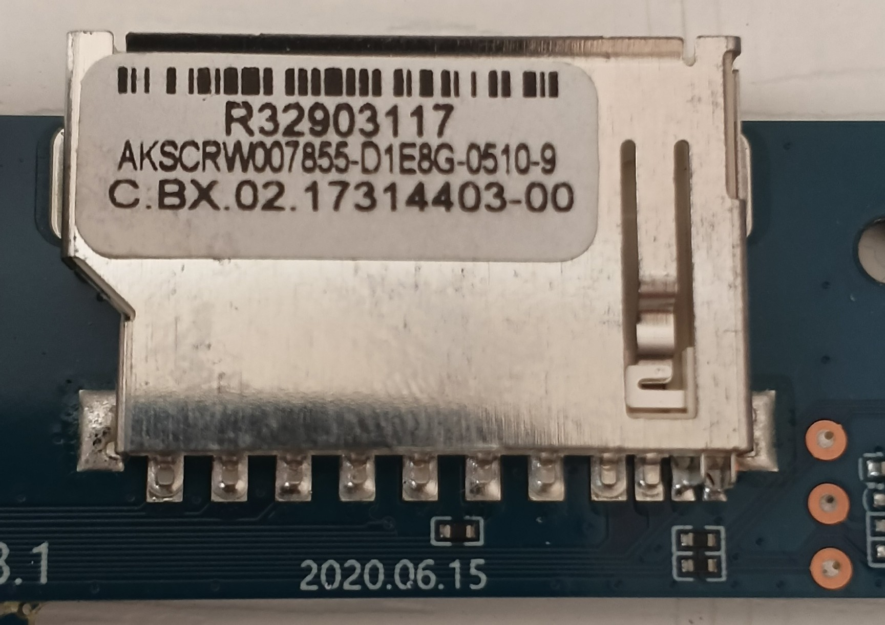

**ДЛЯ ПЕРЕПРОШИВКИ ПРИСТАВКИ УЗНAЁМ ТОЧНЫЕ ДАННЫЕ О ЕГО ПРОЦЕССОРЕ И ЧТО У НЕГО ЗА ПЛАТФОРМА. ОБЫЧНО У ТАКИХ КИТАЙСКИХ АНДРОИД ПРИСТАВОК НАПИСАНЫ НЕПРАВИЛЬНЫЕ ХАРАКТЕРИСТИКИ НА МАРКЕТПЛЕЙСАХ.**

*Поэтому разбираем приставку и узнаём её точную модель по материнской плате:*

**ЕСЛИ ТЕБЕ ПОВЕЗЁТ ТО САМ ПРОИЗВОДИТЕЛЬ ОСТАВИТ ЭТИКЕТКУ О ЕГО НАЧИНКЕ:**

**СЛЕДУЮЩИЙ ЩАГ ЭТО ПОИСК ПРОШИВКИ ДЛЯ ТВОЕЙ МОДЕЛИ, В МОЁМ СЛУЧАИ Я НАШЁЛ ДЛЯ СВОЕЙ МОДЕЛИ НА СЛЕДУЮЩЕМ ФОРУМЕ:**
https://forum.openwrt.org/t/openwrt-22-03-rc6-build-for-tv-boxes-rk322x/134738

**ПОСЛЕ СКАСИВАНИЯ ПРОШИВКИ НАМ НУЖНО УСТАНОВИТЬ ИСТРУМЕНТ `multitool` С ПОПОШЬЮ КОТОРОГО МЫ И УСТАНОВИМ ПРОШИВКУ НА ПРИСТАВКУ:**
https://users.armbian.com/users.armbian.com/jock/web/rk322x/multitool/

**ДАЛЕЕ ДЛЯ ПРОШИВКИ НАМ ПОНАДОБИТСЯ *SD - КАРТА* МИНИМУМ НА 8 ГБ И ПЕРЕХОДНИК ДЛЯ SD КАРТЫ ЧТОБЫ ОНО ВОШЛЁЛ В ПРИСТАВКУ:**

*Примечание: usb накопители не подойдут, ибо сама приставка в режиме восстановления их не видит*

**ДАЛЕЕ КОГДА И ПРОШИВКА И УСТАНОВЩИК УЖЕ СКАЧАНЫ, НАМ НУЖНО ЗАПИСАТЬ `multitiool` НА ФЛЕШКУ:**

**ЗАПИСЬ ПРОИЗВОДИТСЯ ЧЕРЕЗ *HDD Raw Copy Tool.* ДАЛЕЕ ВСТАВЛЯЕМ SD КАРТУ В ПК *(У меня на ноутбуке присутствует разъём для sd карт)*. ДАЛЛЕ ПО ШАГАМ:**
1. Распаковываем `multitool.img.xz` в `multitool.img`, так как *HDD Raw Copy Tool*, не умеет работать с файлами `xz` формата.
2. В *HDD Raw Copy Tool* записываем образ: (более подробно как это делается рассказано в `5` пункте раздела `Роутеры`)

**В ДАННЫЙ МОМЕНТ У ВАС ПОЯВИТСЯ ПРОБЕЛМА, ТО ЧТО ВЫ НЕ СМОЖЕТЕ СКИНУТЬ ФАЙЛ ПРОШИВКИ НА УЖЕ ГОТОВУЮ SD КАРТУ, ТАК КАК *HDD Raw Copy Tool* БЕРЁТ СЛИШКОМ МАЛЫЙ ОБЪЁМ ФЛЕШКИ И ИЗ ЗА ЭТОГО ВАМ ПОКАЖЕТ ОШИБКУ ЧТО НЕХВАТКИ МЕСТА:**

ПОЭТОМУ НУЖНО РАСШИРИТЬ ПРОСТРАНСТВО ЕЩЁ ОДНОЙ УТИЛИТОЙ *MiniTool Partition Wizard.* ПЕРЕХОДИМ НА СЛЕДУЮЩИЙ САЙТ И УСТАНАВЛИВАЕМ:*
https://keysok.ru/akcii/127-besplatnaya-licenziya-klyuch-na-minitool-partition-wizard.html
*ПРИМЕЧАНИЕ: Когда будете вводить ключ активации отключаемся от интернета*

**РАСШИРЯЕМ ПОШАГОВО:**
1. Запусти её. Ты увидишь свою флешку с разделами `BOOTSTRAP` и `MULTITOOL`

2. Нажми правой кнопкой на раздел **`MULTITOOL`** → выбери **«Extend»** (Расширить).
3. В появившемся окне перетащи правую границу раздела до конца флешки
4. Нажми **OK**, затем **Apply** (Применить) в левом нижнем углу.

**ДАЛЕЕ СКИДЫВАЕМ САМУ ПРОШИВКУ НА В РАЗДЕЛ ПО СЛЕДУЮЩЕМУ ПУТИ НА ГОТОВОЙ ФЛЕШКЕ: *MULTITOOL > images > `rk322x-owrt24.10.5.gz` (прошивка)*

**ДАЛЬЩЕ ПОШАГОВО:**
1. Ищем на разобранной плате маленькую спрятанную кнопку `recovery`:
2. 
3. Подключаем плату по hdmi к монитору
4. Одной рукой, иголкой нажимаем кнопку и держим (НЕ ПОДКЛЮЧАЯ К ПИТАНИЮ)
5. Всё ещё придерживая кнопку подключаем провод питания
6. Когда увидим следующую картину можем отпускать (нажимаем `EXIT`)

**ДЛЯ НАЧАЛА ДЕЛАЕМ BACKUP FLASH ЧТОБЫ В СЛУЧАИ ОШИБКИ ПРИСТАВКА НЕ ОКИРПИЧИЛАСЬ**

**ЗАЙМЁТ ОТ 15 ДО 30 МИНУТ**

**ПОСЛЕ СООБЩЕНИЯ *backup is complated* НАЧИНАЕМ СТАВИТЬ САМУ ПРОШИВКУ:**

**ПОСЛЕ ЗАВЕРШЕНИЯ НАЖИМАЕМ *SHUTDOWN*, ВЫТАСКИВАЕМ ФЛЕШКУ С ПЛАТЫ И ВКЛЮЧАЕМСЯ**

**КОНЕЧНЫЙ РЕЗУЛЬТАТ:**

